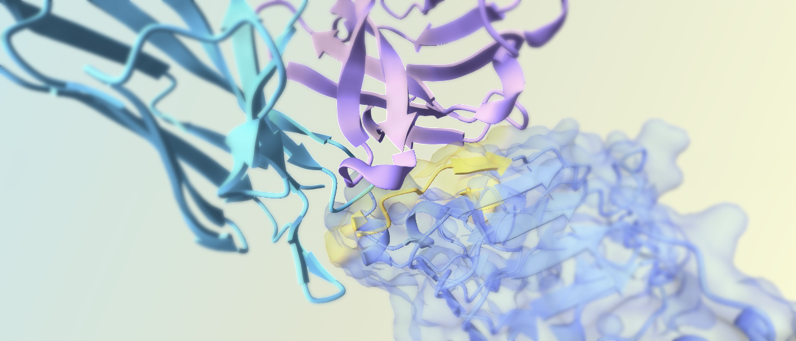
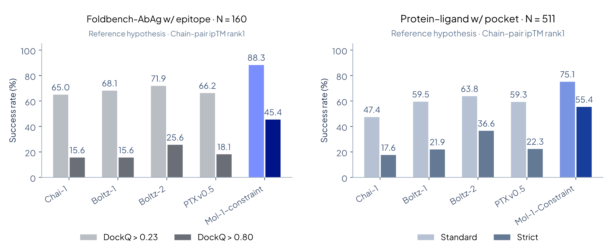
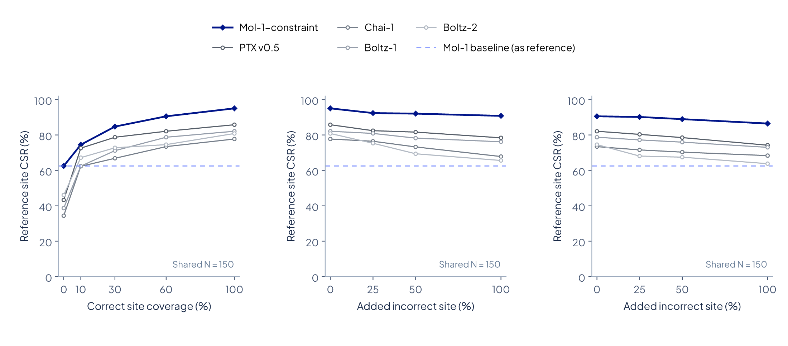

# Mol-1-constraint




<h3 align="center">
  <strong>Mol-1:</strong> Open Frontier Biomolecular Intelligence
</h3>

<p align="center">
  <a href="assets/report.pdf">📄 Mol-1 Technical report</a> ·
  <a href="https://lab.molence.com/">🧪 Molence Lab (Platform)</a> ·
  by <a href="https://www.molence.com/"> Molence Bio</a>
</p>


<div align="center">

[](https://x.com/MolenceBio) 
[](https://www.linkedin.com/company/molence-bio/)
[](https://join.slack.com/t/molence/shared_invite/zt-4ef45vmn5-X9~YKJRQFhb8zEkZ0HP9Iw)
[](mailto:contact@molence.com) \
[](assets/images/wechat-official-account.png)
[](assets/images/wechat-group-3.png)

</div>


## Install

You can install `Mol-1-constraint` with the following commands:

```bash
git clone --branch constraint https://github.com/molence/Mol-1.git
cd Mol-1

pip install -e ".[cuda]"      # NVIDIA GPU
# or
pip install -e ".[cpu]"       # CPU
```

If you are on a CUDA driver whose version is prior to CUDA 13.0, install with `pip install -e ".[cuda12]"` instead.

> The first prediction or training run on a CUDA machine compiles the fused LayerNorm CUDA extension: a couple of minutes with no output but compiler lines, cached per environment afterwards, so a first run that seems to hang is usually still compiling.

## Quick-start

```bash
export MOL_ROOT_DIR="./data"    # model weight and reference data will be put here

bash scripts/database/download_mol_data.sh   # run once: reference data, ~0.3 GB

mkdir -p ${MOL_ROOT_DIR}/checkpoint
# download Mol-1-constraint weights (also downloaded automatically if missing)
wget https://mol-1-release.oss-cn-shanghai.aliyuncs.com/checkpoint/mol-1-constraint.pt \
  -O "${MOL_ROOT_DIR}/checkpoint/mol-1-constraint.pt"

# Optional base weights for Training from base below:
# wget https://mol-1-release.oss-cn-shanghai.aliyuncs.com/checkpoint/mol-1-base.pt \
#   -O "${MOL_ROOT_DIR}/checkpoint/mol-1-base.pt"

# predict a protein–DNA–ligand complex (600 tokens) 
# with three protein residues as binding site 
mol cpred -i examples/7pzb_constraint_binding_site/input.json -o ./output
```

Results land in `output/7pzb_constraint_binding_site/seed_101/predictions/` as 5 CIF structures and their confidence JSON files. Templates are off by default;
see [Template search and align](#template-search-and-align) to enable them.


## Predict with Mol-1-constraint
The easiest way to run Mol-1-constraint prediction is:

```bash
mol cpred -i /path/to/input/json -o /path/to/output/dir
```

**Input format**. `Mol-1-constraint`'s input is a list of "jobs" described by JSON, where each job's `sequences` holds `proteinChain`, `dnaSequence`, `rnaSequence`, `ligand` or `ion` entries, with optional
`covalent_bonds` and residue modifications. Template hits are accepted as
`.a3m`, `.hhr` or JSON. See the details in [input JSON format](docs/infer_json_format.md) and
[`examples/`](examples/), which includes a nanobody case driven by JSON
templates.

**Constraints**. Add SITE, CONTACT or EXCLUSION to the input JSON as described in
[constraint semantics](docs/constraint_semantics.md). The released model supports
all three; each input may use any combination or none. Conditioning guides the
prediction without guaranteeing satisfaction or filtering candidates.

**Optional agent skill (beta).** The
[evidence-to-constraints skill](docs/mol1-evidence-to-constraints/SKILL.md) is a
companion tool for converting experimental observations (e.g., from literature) into
proposed Mol-1 constraint inputs, with source evidence, residue/token mapping, and technical
validation. It is **not required** to use the model. Users are responsible for verifying
the authenticity of the evidence and assessing its scientific interpretation.

Inference defaults to 20 recycles and 200 diffusion steps. Override them with
`--cycle` and `--step`. Note that setting `--use_default_params true` forces 20/200 even when other
budgets are supplied. Other explicit CLI options override `--config` JSON values.

**Prediction outputs**. Results are organized in `output/<job_name>/seed_<seed>/predictions/` as CIF structures with a confidence JSON per sample. Within each seed, samples are numbered by `ranking_score`, highest first, so `sample_0` is that seed's top-ranked structure.

**Confidence scores**. [docs/output_format.md](docs/output_format.md) describes every
field, including two that trip people up — `plddt` is scaled 0–100 while
`chain_plddt` is 0–1, and the PAE matrix is indexed by token rather than by
residue number. The per-token and per-atom data, the PAE matrix among them, go
to a separate `full_data` JSON written only with `--need_atom_confidence true`.

**MSA and template**. For an input of your own, `mol cpred` searches for what the JSON does not carry. 
Protein MSAs come from the public ColabFold MMseqs2 service, so
`--use_msa`, on by default, needs network access. With `--use_template true`,
templates are searched with HMMER against the `search_database/` archive,
starting from the chain's MSA. A `pairedMsaPath`, `unpairedMsaPath` or
`templatesPath` already in the JSON skips the matching search. The
[MSA and template pipeline](docs/msa_template_pipeline.md) describes the files.

**RNA MSAs**. RNA MSAs are off by default. With `--use_rna_msa true`, RNA chains without an
`unpairedMsaPath` are searched with HMMER against three further sequence
databases (Rfam, RNAcentral and an NCBI `nt` RNA subset, tens of gigabytes) that
the release archives do not include; [docs/data_sources.md](docs/data_sources.md)
names them.

**Script example**. `bash inference_demo.sh` runs the prepared
[7PZB binding-site example](examples/7pzb_constraint_binding_site/input.json)
through `mol/constraint/inference.py`, reusing its MSAs with templates disabled.
Set `CHECKPOINT_PATH` to use custom weights; additional native runner options
can be appended to the script command.

### Template search and align
The example `examples/examples_with_template/example_9fm7.json` carries precomputed MSAs and template hits, but using templates still needs `kalign`, which aligns every hit to the query; the hit structures are downloaded from PDBe on first use. Template search for your own inputs also needs HMMER. Install both:

```bash
sudo apt-get install hmmer kalign

# or, in a conda environment (keep the kalign3 pin: later releases align differently)
conda install -c conda-forge -c bioconda --override-channels hmmer kalign3=3.3.5

# predict example with template
mol cpred -i examples/examples_with_template/example_9fm7.json -o ./output \
  --use_template true
```


## Commands

`mol` has these commands:

| Command | What it does |
| ------- | ------------ |
| `mol cpred` | Run Mol-1-constraint inference |
| `mol pred` | Run base-model inference with base weights |
| `mol json` | Convert PDB/CIF structures to Mol-1 JSON |
| `mol msa` | Protein MSA search |
| `mol prep` | MSA and template search; RNA MSA search with `--use_rna_msa true` |
| `mol doctor` | Environment diagnostics |

Use `mol <command> --help` to list the options for each.

For example:

```bash
mol json --input examples/7pzb.pdb --out_dir ./output      # structure to input JSON
mol msa --input examples/prot.fasta --out_dir ./output     # MSAs per FASTA record, listed in msa_index.json
mol prep --input examples/input.json --out_dir ./output    # MSAs and templates an input lacks
```

## Weights and data

Quick-start fetches everything prediction needs. For fine-tuning,
`bash scripts/database/download_mol_data.sh --full` also fetches the
precomputed MSAs and template hits (9.8 GB, 46 GB extracted).
[docs/data_sources.md](docs/data_sources.md) lists every archive with its
contents and download link.

`mol cpred` uses `$MOL_ROOT_DIR/checkpoint/mol-1-constraint.pt`, downloading the
[released Mol-1-constraint weights](https://mol-1-release.oss-cn-shanghai.aliyuncs.com/checkpoint/mol-1-constraint.pt)
there if missing. Pass `--load_checkpoint_path /path/to/mol-1-constraint.pt` to
use custom weights; an explicit path must exist and is never replaced by a download.
Regular and EMA exports both load the supplied `model` tensors directly.
Loading is strict: model branches, tensor shapes and checkpoint metadata must match.
Base weights for training are available from the commented download command in
[Quick-start](#quick-start).


## Fine-tune Mol-1

You may find it useful to fine-tune Mol-1 by building a training dataset from your own **mmCIF** files. The repository includes a **six-structure dataset** to try it on:

```bash
# convert structures -> bioassembly dicts
mkdir -p finetune_data
ls scripts/msa/data/mmcif/*.cif examples/finetune/*.cif > finetune_data/structures.txt
# prepare chain/interface index table
python3 scripts/prepare_training_data.py -i finetune_data/structures.txt \
  -b finetune_data/bioassembly -o finetune_data/indices.csv \
  -c "$MOL_ROOT_DIR/common/clusters-by-entity-40.txt"

# prepare protein MSAs, through the same search service as inference (recommended)
python3 scripts/prepare_finetune_msa.py -b finetune_data/bioassembly \
  -o finetune_data/msa
```

The fine-tuning script reads `FINETUNE_DATA_DIR` (default `./finetune_data`).

Fine-tune base weights:
```bash
CHECKPOINT_PATH="${MOL_ROOT_DIR}/checkpoint/mol-1-base.pt" bash finetune_demo.sh \
  --max_steps 6 --checkpoint_interval 3
```

Dataset preparation and base fine-tuning options are described in
[docs/finetune.md](docs/finetune.md).


## Environment diagnosis

`mol doctor` reports the PyTorch build, the GPUs it sees, which kernels `auto`
picks, the preprocessing binaries and the data it finds. It is read-only and
loads no model; run it before filing a bug.
[docs/installation.md](docs/installation.md#verify) shows a report and what to
look for in it.


## Benchmarks

**Comparison with constraint models.** Mol-1-constraint, Chai-1, Boltz-1,
Boltz-2 and Protenix-v0.5 receive reference-derived binding-site (interface residue) constraint as input.
The left panel covers 160 FoldBench antibody–antigen interfaces (epitope, success DockQ >0.23
and >0.80); the right covers 511 protein–ligand interfaces (pocket, standard success requires iLDDT ≥0.8 and ligand RMSD ≤2 Å; strict success requires ≥0.9 and ≤1.5 Å in the same candidate). Results select the top-1 candidate by chain-pair ipTM from 5 seeds with 5 samples per seed. This comparison measures how models use it.



**Robustness to incomplete and incorrect site inputs.** All five constraint models share 150 antibody–antigen interfaces, ranked by chain-pair
ipTM. From left to right: increasing correct-site coverage; adding incorrect
residues to the full reference site; and adding incorrect residues to a 60%
reference site. Curves show reference binding-site contact recovery (CSR); the dashed line is Mol-1 performance for comparison.




## Documentation

- [Installation](docs/installation.md)
- [Fine-tuning on your own structures](docs/finetune.md)
- [Preparing training data](docs/prepare_training_data.md)
- [Input JSON format](docs/infer_json_format.md)
- [Constraint semantics and input examples](docs/constraint_semantics.md)
- [Evidence-to-constraints skill](docs/mol1-evidence-to-constraints/SKILL.md)
- [Output format](docs/output_format.md)
- [Kernel options](docs/kernels.md)
- [Inference memory controls](docs/inference_memory.md)
- [Reference data](docs/data_sources.md)
- [MSA and template pipeline](docs/msa_template_pipeline.md)

## Acknowledgements

Third-party attributions and license information are provided in [THIRD_PARTY_NOTICES.md](THIRD_PARTY_NOTICES.md). 


## Citation

Coming soon :)

## Contributing

See [CONTRIBUTING.md](CONTRIBUTING.md) and
[CODE_OF_CONDUCT.md](CODE_OF_CONDUCT.md).

## License

Apache License 2.0. See [LICENSE](LICENSE).
